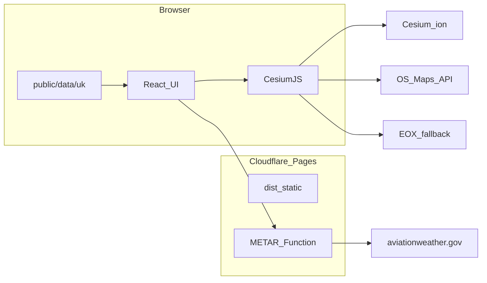

# Architecture — VoluSpace

## Runtime

## Data pipeline

[`scripts/build-data.ts`](../scripts/build-data.ts) downloads OpenAIP `gb_*` exports, normalises limits, classifies categories, merges [`data/overrides/`](../data/overrides/), writes [`public/data/uk/`](../public/data/uk/).

Heights: FL → standard pressure; AMSL → ellipsoid + UK geoid estimate; AGL/GND → terrain sample at load in the client.

## Rendering

Airspace volumes use extruded polygons + polyline edges ([`src/cesium/airspaceLayer.ts`](../src/cesium/airspaceLayer.ts)). Picking uses primitive instance ids.

## Deferred (see plan)

Live ADS-B, NOTAM activation, worldwide sections, accounts, offline PWA, full cross-section terrain profile, route checker geometry, R2 self-hosted OS tiles.

## Product name

Working title **VoluSpace** (STARLING-Airspace repo). Rename repo/domain when marketing name is final.
