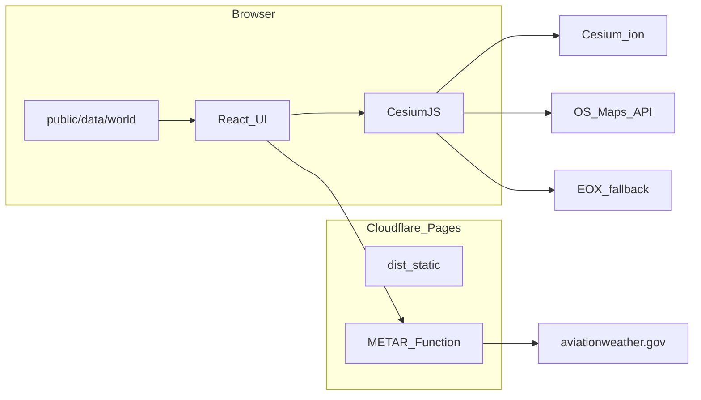

# Architecture — Airspace 3D

## Runtime

## Data pipeline

[`scripts/build-data.ts`](../scripts/build-data.ts) downloads OpenAIP exports for the Europe & North America country list, normalises limits, classifies categories, merges [`data/overrides/`](../data/overrides/), writes [`public/data/world/`](../public/data/world/) (10° airspace cells plus search index and airports). Cell JSON is generated at build time and gitignored.

Heights: FL → standard pressure; AMSL → ellipsoid + coarse global geoid estimate; AGL/GND → terrain sample at load in the client. The viewer loads only airspace cells near the camera.

## Rendering

Airspace volumes use extruded polygons + polyline edges ([`src/cesium/airspaceLayer.ts`](../src/cesium/airspaceLayer.ts)). Picking uses primitive instance ids.

## Deferred (see plan)

Live ADS-B, NOTAM activation, worldwide sections, accounts, offline PWA, full cross-section terrain profile, route checker geometry, R2 self-hosted OS tiles.

## Product name

Product name **Airspace 3D** (repo folder may remain STARLING-Airspace until renamed on GitHub).
